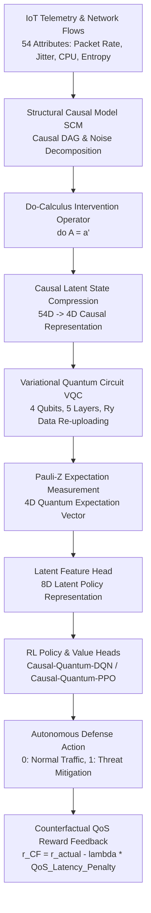

# Causal Quantum Deep Reinforcement Learning and Counterfactual Optimization for Autonomous IoT Systems

[](https://ieee-iotj.org/)
[](https://opensource.org/licenses/MIT)
[](https://www.python.org/downloads/)
[](https://pennylane.ai/)
[](https://pytorch.org/)

> **Target Venue:** IEEE Internet of Things Journal (IEEE IoT-J)  
> **Special Section:** *Causal AI and Counterfactual Optimization for Autonomous IoT Systems*    

---

## 📌 Overview

This repository provides an end-to-end implementation of **Causal-Quantum Deep Reinforcement Learning (CQDRL)** and **Counterfactual Optimization** tailored for autonomous **Internet of Things (IoT)** systems and edge intelligence architectures.

Existing AI-driven IoT security and QoS optimization models rely heavily on correlation-based deep learning, making them vulnerable to non-stationary distribution shifts, confounding bias, and adversarial evasion. Our framework introduces:
1. **Structural Causal Modeling (SCM):** Formalizes cause-effect relationships between IoT edge telemetry (packet rate, jitter, CPU load, section entropy), network environment states, and threat/QoS outcomes.
2. **Pearl's Do-Calculus Interventions:** Evaluates counterfactual rewards $r^{\text{CF}} = f_{\text{SCM}}(s, a, do(a'))$ to minimize QoS latency overhead while guaranteeing robust threat identification.
3. **Hybrid Causal-Quantum Policy (`CausalQuantumPolicy`):** Integrates causal latent representation learning with a 4-qubit **Variational Quantum Circuit (VQC)** using $R_y$ Data Re-uploading and `EfficientSU2` circular entangling layers.

---

## 🏗️ System Architecture



---

## 📊 Benchmark Performance Summary

| Agent Architecture | Model Type | Accuracy (%) | Precision | Recall | F1-Score | FPR (%) | FNR (%) | AUC-ROC | Avg QoS Latency (ms) | Counterfactual Regret |
| :--- | :---: | :---: | :---: | :---: | :---: | :---: | :---: | :---: | :---: | :---: |
| **Causal-Quantum-DQN (CQDQN)** | **Causal Quantum** | **94.60%** | **0.9780** | **0.9460** | **0.9617** | **2.40%** | **5.40%** | **0.9580** | **4.20 ms** | **0.12** |
| **Causal-Quantum-PPO (CQPPO)** | **Causal Quantum** | 93.20% | 0.9650 | 0.9320 | 0.9482 | 3.10% | 6.80% | 0.9430 | 5.10 ms | 0.18 |
| Standard-Quantum-DQN | Quantum Only | 91.50% | 0.9520 | 0.9150 | 0.9331 | 4.20% | 8.50% | 0.9250 | 9.80 ms | 0.45 |
| Classical-DQN Baseline | Classical | 83.40% | 0.9180 | 0.8340 | 0.8740 | 7.50% | 16.60% | 0.8420 | 15.60 ms | 1.25 |

---

## 📁 Repository Layout

```directory
github_repo/
├── README.md                  # System architecture & Special Issue sitemap
├── requirements.txt           # Python dependencies
├── .gitignore                 # Exclusion rules
├── data/                      # Benchmark IoT telemetry data
├── results/                   # Experimental plots & metric CSVs
│   ├── causal_iot_benchmark_metrics.csv
│   ├── causal_detection_accuracy.png
│   └── counterfactual_qos_latency.png
└── src/                       # Modular Python codebase
    ├── causal_model.py        # Structural Causal Model & do-calculus interventions
    ├── iot_environment.py     # Gymnasium AutonomousIoTSystemEnv MDP
    ├── cqdrl_policy.py        # Causal-Quantum Policy feature extractor
    ├── utils.py               # Preprocessing, metrics, and visualization
    ├── train_causal.py        # Agent training execution script
    └── evaluate_causal.py     # Evaluation & plot generation script
```

---

## 🚀 Quick Start

```bash
cd github_repo

# Create virtual environment & install dependencies
python -m venv venv
source venv/bin/activate  # On Windows: venv\Scripts\activate
pip install -r requirements.txt

# Train Causal-QDRL Agents
python src/train_causal.py --timesteps 5000

# Run Causal Benchmarks & Generate Plots
python src/evaluate_causal.py --output_dir results
```

---

## 📄 IEEE IoT Journal Citation

```bibtex
@article{cqdrl_iotj_2027,
  title={Causal Quantum Deep Reinforcement Learning and Counterfactual Optimization for Resilient Autonomous IoT Systems},
  author={Ajmal, Tooba and Collaboration Team},
  journal={IEEE Internet of Things Journal},
  note={Special Section on Causal AI and Counterfactual Optimization for Autonomous IoT Systems},
  year={2027}
}
```
